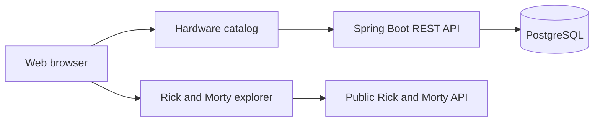
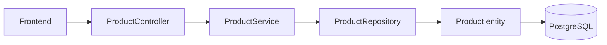
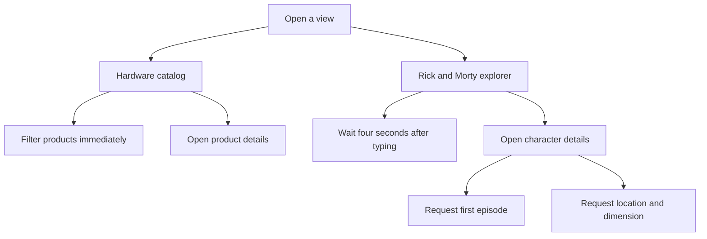

# Hardware and Rick and Morty Catalog

## Project overview

This project is a responsive web application with two views:

1. A hardware catalog connected to a Spring Boot REST API and PostgreSQL.
2. A Rick and Morty explorer connected to the public Rick and Morty API.

The project is organized as a monorepo. The backend and frontend are developed
separately and are integrated through the `dev` branch.

## Technologies

### Backend

- Java 21.
- Spring Boot 3.5.6.
- Spring Web and Spring MVC.
- Spring Data JPA and Hibernate.
- Lombok.
- Maven.
- PostgreSQL.

### Frontend

- HTML5.
- Tailwind CSS through CDN.
- JavaScript ES modules.
- jQuery for the hardware catalog.
- Native `fetch`, Promises, and `async`/`await`.

### Development tools

- Git and GitHub.
- IntelliJ IDEA for the backend.
- Visual Studio Code and Live Server for the frontend.
- Podman and Podman Compose for PostgreSQL.
- Jira for task management.

Keycloak, AWS, Docker Hub publishing, GitHub Actions, and end-to-end testing
are planned for later tasks. They are not part of the current implementation.

## Architecture



### Backend MVC flow



### User interaction flow



## Project structure

```text
catalog-api-monorepo/
├── backend/
│   ├── pom.xml
│   └── src/
│       ├── main/
│       │   ├── java/com/catalog/api/
│       │   │   ├── controller/
│       │   │   ├── model/
│       │   │   ├── repository/
│       │   │   ├── service/
│       │   │   └── CatalogApiApplication.java
│       │   └── resources/
│       │       ├── application.properties
│       │       ├── data.sql
│       │       └── schema.sql
│       └── test/
├── frontend/
│   ├── services/
│   │   ├── api.service.js
│   │   └── catalog.service.js
│   └── views/
│       ├── api.html
│       └── index.html
├── compose.yaml
├── .gitignore
└── README.md
```

Generated folders such as `backend/target/` and local IDE settings are
ignored and must not be committed.

## Backend API

The backend runs on `http://localhost:8080`.

| Method | Endpoint | Description |
|---|---|---|
| `GET` | `/api/health` | Check that the API is running |
| `GET` | `/api/products` | Get all products |
| `GET` | `/api/products/{id}` | Get one product |
| `POST` | `/api/products` | Create a product |
| `PUT` | `/api/products/{id}` | Update a product |
| `DELETE` | `/api/products/{id}` | Delete a product |

Products contain an id, name, brand, category, description, image URL, price,
and stock. The initial catalog data is inserted by `data.sql`.

## Frontend behavior

### Hardware catalog

The catalog loads products from `/api/products` and renders the cards
dynamically with jQuery and `map`. The search filters by name, brand,
category, or description without a delay. The cards use responsive columns and
open a product details modal when clicked.

### Rick and Morty explorer

The explorer loads initial characters from:

```text
https://rickandmortyapi.com/api/character
```

Character searches use a four-second debounce. When a character card is
selected, the application:

1. Requests the selected character.
2. Requests the first episode from the character response.
3. Requests the character location and dimension.
4. Displays the combined information in a modal.

## Local setup

### 1. Start PostgreSQL with Podman

From the repository root:

```bash
podman compose up -d postgres
```

Check the database:

```bash
podman exec catalog-postgres pg_isready -U catalog -d catalog
```

The expected result is:

```text
accepting connections
```

### 2. Start the backend

Use IntelliJ IDEA to run `CatalogApiApplication`, or run:

```bash
mvn -f backend/pom.xml spring-boot:run
```

Check the API:

```bash
curl http://localhost:8080/api/health
```

### 3. Start the frontend

Open `frontend/views/index.html` with VS Code Live Server. The default
frontend URL is:

```text
http://localhost:5500/frontend/views/index.html
```

The second view is available at:

```text
http://localhost:5500/frontend/views/api.html
```

The backend allows local frontend requests from `localhost:5500` and
`127.0.0.1:5500`.

### 4. Run tests

```bash
mvn -f backend/pom.xml clean test
```

## Git workflow

```text
feature/fix/docs branch → dev → test → main
```

- Work is created in a Jira-linked branch.
- A Pull Request promotes the work branch to `dev`.
- `dev` is promoted to `test` for quality validation.
- `test` is promoted to `main` for production.

The current branch structure is:

```text
main  = production
test  = quality assurance
dev   = development integration
```

All source code, documentation, variables, and user-facing text must remain
in English.
