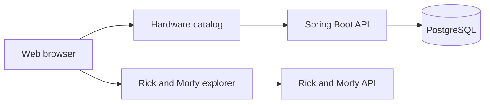

# Hardware and Rick and Morty Catalog

## Project description

This project is a responsive web application with two planned views:

1. A hardware product catalog with product cards and search.
2. A Rick and Morty explorer that combines data from multiple API endpoints
   and provides delayed search.

The project is currently in its initial setup stage. The documentation and
project structure will be expanded as each feature is implemented.

## Technology stack

- **Frontend:** HTML5, Tailwind CSS, JavaScript ES modules, jQuery, and the
  Fetch API.
- **Backend:** Java 21, Spring Boot, and Lombok.
- **Database:** PostgreSQL.
- **Containers:** Podman and Podman Compose for local development.
- **Image registry:** Docker Hub for storing OCI-compatible container images.
- **Project management:** Jira Scrum.
- **Source control and delivery:** GitHub and GitHub Actions.

Podman is the local container engine. Docker Engine is not required for local
development. Docker Hub is used as a remote image registry and does not
determine which container engine is used locally.

## Planned architecture



The architecture will evolve as the frontend, backend, database, and
container configuration are implemented.

## Development workflow

Work is organized in Jira and delivered through the following branches:

```text
feature or docs branch → dev → test → main
```

- `dev` is the development integration branch.
- `test` is the quality assurance branch.
- `main` is the production branch.
- Pull Requests are used to promote changes between branches.

## Current status

The repository contains the initial project documentation. Application
features, REST endpoints, database entities, authentication, and CI/CD
workflows will be implemented in subsequent tasks.
